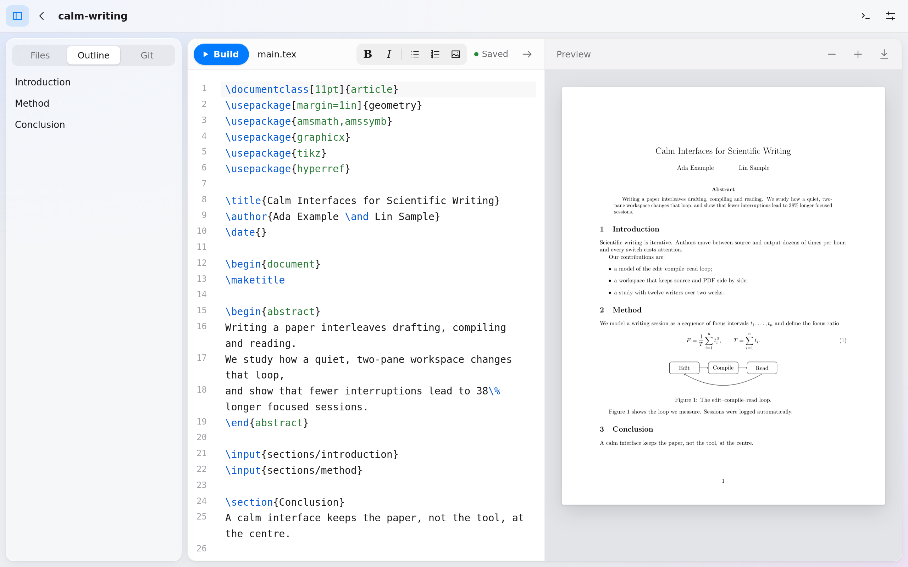
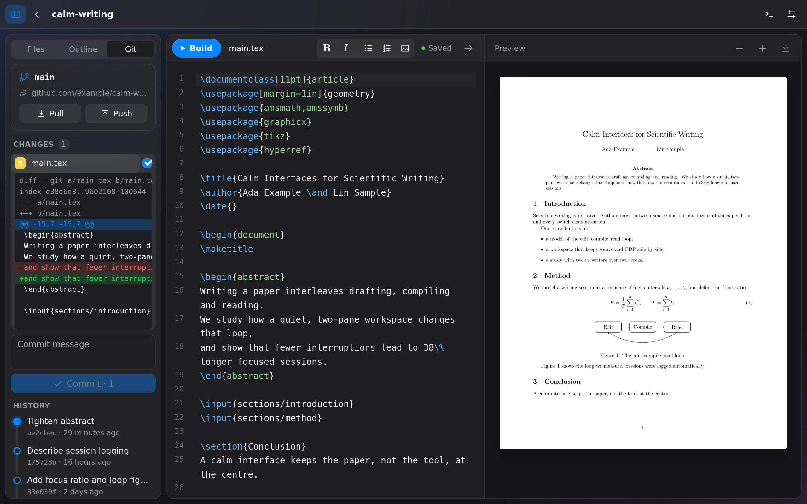

# LaTeX Studio

A quiet LaTeX writing workspace for DeepSeek Harness (DSH).
Source on the left, PDF on the right, your paper stays an ordinary Git folder.



- **Write**: CodeMirror editor with LaTeX highlighting, autosave with revision
  checks, and one-click bold, italic, itemize, enumerate and figure.
- **Compile**: a private, checksum-pinned TinyTeX prepared on first use. Missing
  packages are fetched on demand. pdfLaTeX, XeLaTeX and LuaLaTeX via latexmk,
  BibTeX and Biber included. Builds run when you ask, plus every 5 minutes if
  the source changed (adjustable or off).
- **Read**: PDF.js preview with two-way SyncTeX, zoom, text selection and a
  document outline that follows `\input` / `\include`.
- **Git**: branch, ahead/behind, pull and push, colour-coded changes with inline
  diffs, commit selected files, and a commit timeline. Your existing Git, SSH
  and `gh` login is reused; no tokens are collected.
- **Import**: open any folder (an Overleaf export works), create a new paper, or
  clone a GitHub repository with live progress.
- **Look**: macOS-style glass interface in light and dark, usable on a phone.



AI integration (editing alongside an assistant on the open paper) is in progress
and will be released later.

## Install

Requires DeepSeek Harness 0.2.2-rc.1 or later and Node.js 22+. macOS on Apple
Silicon is the primary desktop target; Linux works for server hosts; Windows is
not supported yet.

1. Download `cbzheng-dsh-latex-VERSION.tgz` and `SHA256SUMS` from the latest
   [release](https://github.com/cbzheng/dsh-latex/releases/latest) into one
   folder and run `shasum -a 256 -c SHA256SUMS` (Linux: `sha256sum -c`).
2. In DSH open **Plugins → Install**, choose the local archive, enable LaTeX
   Studio and restart DSH if asked.
3. Open **LaTeX Studio** from the DSH sidebar.

Or from the command line, using the same profile and `DSH_HOME` as your DSH:

```sh
dsh plugin --profile desktop add ./cbzheng-dsh-latex-VERSION.tgz --ignore-scripts
```

No MacTeX, global TeX, R or `PATH` changes are needed. The first compile needs
network access to prepare TeX; prepared projects can then build offline. See the
[user guide](docs/installation.md) ([中文](docs/installation-zh.md)) for details.

## Development

```sh
npm ci
npm test                       # portable backend and UI-logic tests
npm run build                  # installable archive in dist/ (or $LATEX_BUILD_DIR)
node scripts/dev.mjs           # loopback dev server with synthetic data
node scripts/integration.mjs   # real TeX and Git acceptance on temporary documents
```

`LATEX_STUDIO_DATA` overrides where private plugin state is kept. Tests and
scripts only use synthetic documents. See [architecture](docs/architecture.md).

## License

MIT. Bundled third-party components are listed in
[THIRD_PARTY_NOTICES.md](THIRD_PARTY_NOTICES.md).
